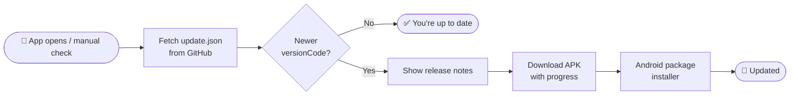

<div align="center">

# 📋 ClipNest

### Your Clipboard. Your History. Your Control.

A modern Android clipboard manager that keeps everything you copy — persistent, organized, and one tap away.

<br />


<br />

[**⬇️ Download**](../../releases) &nbsp;•&nbsp;
[**✨ Features**](#-features) &nbsp;•&nbsp;
[**🔄 Updates**](#-in-app-updates) &nbsp;•&nbsp;
[**🔒 Privacy**](#-privacy--security) &nbsp;•&nbsp;
[**📍 Roadmap**](#-roadmap)

</div>

<br />

---

## 💡 Why ClipNest?

> Copying something useful should never mean losing it the next time you copy something else.

Your keyboard's clipboard forgets. Android's system clipboard holds exactly **one** thing. ClipNest sits in between and quietly keeps your history — text, links, snippets — so you can find it and reuse it whenever you need it.

<br />

## ✨ Features

<table>
<tr>
<td width="50%" valign="top">

### 📋 Clipboard History
Keep copied text and links accessible long after you've copied something new.

</td>
<td width="50%" valign="top">

### ⚡ Automatic Capture
Captures supported clipboard content automatically, wherever Android allows it. Manual sync is there as a fallback.

</td>
</tr>
<tr>
<td width="50%" valign="top">

### 💾 Persistent Storage
Your history survives app restarts. Close it, reopen it — it's still there.

</td>
<td width="50%" valign="top">

### ⏳ Custom Retention
Decide how long entries live, including a **never-expire** option where supported.

</td>
</tr>
<tr>
<td width="50%" valign="top">

### 🔁 Quick Reuse
Tap a saved entry to copy it again. No more hunting through old apps and chats.

</td>
<td width="50%" valign="top">

### 🎨 Modern, Themeable UI
Fixed themes and dynamic (wallpaper-derived) colors, depending on the build.

</td>
</tr>
<tr>
<td colspan="2" valign="top">

### 🔄 In-App Updates
Check GitHub-hosted metadata, see what's new, and download the latest APK with live progress — no Play Store required.

</td>
</tr>
</table>

<details>
<summary><b>⚠️ A note on Android's clipboard limits</b></summary>

<br />

Background clipboard access varies by Android version and by what the app is doing at that moment. Automatic capture should **not** be assumed to work continuously in every app or situation — that's an Android platform rule, not a bug. Use the manual sync option when auto-capture can't reach the clipboard.

</details>

<br />

## 🚀 Installation

### 📦 Option 1 — Install a release (recommended)

1. Go to the [**Releases**](../../releases) page.
2. Download the latest `.apk` asset.
3. Open it on your Android device.
4. Allow *Install unknown apps* if Android asks.
5. Finish the install through the system installer. Done ✅

> [!WARNING]
> Only install APKs from sources you trust.

### 🛠️ Option 2 — Build from source

<details>
<summary><b>Show build steps</b></summary>

<br />

Requires the project source and a working Android environment.

1. Install a compatible **JDK** and the **Android SDK**.
2. Open the project in **Android Studio**.
3. Sync Gradle and resolve any missing SDK components.
4. Build the debug or release APK.

```bash
./gradlew assembleDebug
```

> This applies only if the repository contains a Gradle wrapper and Android build config. Confirm language, min SDK, target SDK, storage tech and package ID from the actual project before treating them as fixed specs.

</details>

<br />

## 🔄 In-App Updates

ClipNest keeps **version info** and **APK downloads** separate, so checking for updates stays tiny and fast.



| Component | Role |
|---|---|
| `update.json` | Describes the latest published version |
| GitHub Releases | Hosts versioned APK assets |
| Version metadata | Identifies the release and what changed |
| Android package installer | Handles the user-approved install |

<details>
<summary><b>Example <code>update.json</code></b></summary>

<br />

Illustrative only — not a live endpoint. Field names must match the app's implementation.

```json
{
  "versionCode": 2,
  "versionName": "1.1",
  "releaseNotes": "Improvements and bug fixes",
  "apkUrl": "https://example.com/clipnest.apk"
}
```

</details>

> [!IMPORTANT]
> For in-place updates to work, every release must keep the **same application ID and signing certificate**, and `versionCode` must always increase. Never reuse or lower it.

<br />

## 🔒 Privacy & Security

Clipboard data can contain passwords, OTPs, private messages and personal info — so ClipNest is built around a few principles:

- 🧭 **You're in control** of your history and how long it's kept.
- 🚫 **No unnecessary collection** or transmission of clipboard content.
- 🧹 **Retention settings** are applied consistently.
- 🙈 **No private entries in logs** or diagnostic reports.
- 🌐 **Network use is disclosed** — updates come only from trusted release endpoints.
- 🔑 **Signing credentials** are kept secure.

> [!NOTE]
> Actual privacy guarantees depend on the implementation. Verify them against the source code.

<br />

## 🧱 Tech Overview

| Layer | Purpose |
|---|---|
| Android app | The clipboard management experience |
| Local persistence | History that survives restarts |
| Clipboard integration | Captures supported copied content |
| Theme system | Fixed + dynamic appearance |
| Update metadata | Describes published versions |
| GitHub Releases | Distributes versioned APKs |

<br />

## 📍 Roadmap

- [ ] Improve auto-capture reliability within Android's limits
- [ ] History navigation and **search**
- [ ] Smarter retention and cleanup
- [ ] Launcher icon and branding polish
- [ ] Accessibility and theme consistency
- [ ] Stronger update validation and error handling
- [ ] Install/upgrade testing across Android versions
- [ ] Performance and resource efficiency
- [ ] More automated tests for key workflows

> Roadmap items are goals, not promises of already-shipped features.

<br />

## 🤝 Contributing

Bug reports, ideas and PRs are welcome.

1. 🔍 Check if the issue already exists.
2. 📝 Describe the problem clearly, with reproducible steps.
3. 🧪 Test on the relevant Android version and device.
4. 🎯 Keep changes focused and maintainable.

### 🐞 Reporting a bug

Please include: **Android version · device model · ClipNest version · steps to reproduce · expected vs actual behaviour · error messages** (with personal info removed).

> [!CAUTION]
> Never paste real clipboard entries, passwords, OTPs or private messages into public issues.

<br />

## 🧭 Principles

| | |
|---|---|
| 🪶 **Simplicity** | Make everyday clipboard tasks easier |
| 🛡️ **Reliability** | Preserve history, handle errors sensibly |
| 🎛️ **Control** | Real control over retention and appearance |
| ⚡ **Performance** | No unnecessary complexity or resource use |
| 🔍 **Transparency** | Honest about limits and update behaviour |
| 🧩 **Maintainability** | A codebase and release flow people can follow |

<br />

## 📄 License

No license has been specified yet. Check the repository for a `LICENSE` file before using, modifying or redistributing ClipNest. Without one, don't assume unrestricted reuse rights.

<br />

---

<div align="center">

**ClipNest — A simpler way to keep what you copy.**

Made with ❤️ by **Subham Kumar Prusty**

</div>
